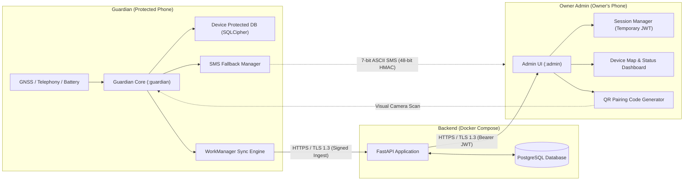

# System Architecture: Android Anti-Theft & Recovery System

This document outlines the end-to-end architecture across the mobile apps and backend infrastructure, incorporating Phase 2 trimming guidelines (plain Android library, ECDSA P-256, simplified Phase 2 schema, temporary Phase 2 auth, and two-stage low-battery dispatch).

---

## 1. System Topology Overview



---

## 2. Project & Module Structure

The project deliberately avoids Kotlin Multiplatform (KMP) complexity, utilizing standard Android Gradle modules and a shared plain Android library:

```text
she/
├── android/
│   ├── app-guardian/         # Guardian mobile application (:guardian)
│   │   ├── src/main/java/com/antitheft/guardian/
│   │   │   ├── directboot/   # Direct Boot receivers & DE storage context
│   │   │   ├── location/     # Autonomous GNSS tracking & two-stage battery-low beacon
│   │   │   ├── sms/          # 7-bit ASCII SMS serializer & 48-bit HMAC receiver
│   │   │   ├── sync/         # WorkManager offline sync engine
│   │   │   └── ui/           # Status UI & Tier 1 System Checklist
│   │   └── build.gradle.kts
│   ├── app-admin/            # Owner Admin application (:admin)
│   │   ├── src/main/java/com/antitheft/admin/
│   │   │   ├── auth/         # JWT session management (Temporary Phase 2)
│   │   │   ├── dashboard/    # Device list, Live/Delayed/Unavailable indicators
│   │   │   ├── map/          # Location trace & accuracy radius visualization
│   │   │   └── pairing/      # QR code generation & enrollment
│   │   └── build.gradle.kts
│   └── common-core/          # Plain Android Library (:common)
│       ├── src/main/java/com/antitheft/common/
│       │   ├── crypto/       # ECDSA P-256 Keystore wrapper & 48-bit HMAC-SHA256
│       │   ├── protocol/     # 7-bit ASCII SMS PDU formatter & parser
│       │   ├── models/       # Shared DTOs, LocationEvent, DeviceStatus
│       │   └── db/           # SQLCipher database open helper
│       └── build.gradle.kts
├── backend/
│   ├── app/
│   │   ├── api/              # FastAPI route endpoints (/auth, /devices, /locations)
│   │   ├── core/             # JWT tokens, password hashing, config
│   │   ├── db/               # SQLAlchemy models & database session
│   │   └── schemas/          # Pydantic request/response schemas
│   ├── alembic/              # Database migration versions
│   ├── tests/                # Pytest integration & unit tests
│   ├── Dockerfile
│   ├── docker-compose.yml
│   └── requirements.txt
└── docs/                     # Engineering documentation
```

---

## 3. Cryptographic Specification

### 3.1 Asymmetric Identity: ECDSA P-256 (`secp256r1`)
- **Key Storage**: Keys generated inside `AndroidKeyStore` with `KeyProperties.KEY_ALGORITHM_EC` and curve `secp256r1`.
- **Signature Algorithm**: `SHA256withECDSA`.
- **Rationale over Ed25519**: ECDSA P-256 has verified, hardware-backed Keystore implementation across all Android versions from API 23 through API 35.

### 3.2 SMS Integrity: 48-Bit Truncated HMAC-SHA256
- **Secret Exchange**: A 256-bit random symmetric key $K_{\text{sms}}$ is generated during initial QR code pairing.
- **Computation**:
  $$\text{HMAC}_{48} = \text{Truncate}_{12\text{ hex}}(\text{HMAC-SHA256}_{K_{\text{sms}}}(\text{payload}))$$
- **Characteristics**: Exact 12 hex characters (6 bytes / 48 bits). Provides $2.81 \times 10^{14}$ search space, safe against brute-force in rate-limited SMS channels while preserving GSM 7-bit single PDU limits.

### 3.3 Database Encryption: SQLCipher for Android
- **Artifact**: `net.zetetic:sqlcipher-android:4.5.5` pinned dependency.
- **Engine**: 256-bit AES-CBC with HMAC-SHA512 per-page authentication.
- **Passphrase Storage**: Keystore-wrapped AES-256-GCM master key.

---

## 4. Phase 2 Backend Schema & Owner Authentication

> [!IMPORTANT]
> **Owner Sign-In Security Boundary**:
> Password + JWT authentication is strictly a **temporary baseline for Phase 2 MVP only**.
> **Rule for Phase 3**: Before any remote command endpoint (`ring`, `lock`, `mark_stolen`) is implemented in Phase 3, a second authentication factor (WebAuthn/Passkey or TOTP) **and** trusted-device approval MUST be enforced. A password alone must NEVER be capable of locking or ringing a protected device.

### 4.1 Owner Authentication Flow (Phase 2 MVP)
1. **Registration / Login**: Owner signs in via `POST /auth/login` (FastAPI OAuth2 password flow with Argon2id password hash).
2. **Session Token**: Backend issues a signed Bearer JWT (30-minute expiration) with user ID claim.
3. **Admin App Usage**: Owner Admin stores JWT securely in `EncryptedSharedPreferences`.

### 4.2 Database Relational Schema (Phase 2 MVP)

```sql
-- Users table
CREATE TABLE users (
    id UUID PRIMARY KEY DEFAULT gen_random_uuid(),
    username VARCHAR(64) UNIQUE NOT NULL,
    email VARCHAR(255) UNIQUE NOT NULL,
    hashed_password VARCHAR(255) NOT NULL,
    created_at TIMESTAMPTZ NOT NULL DEFAULT NOW()
);

-- Trusted Admin Devices table
CREATE TABLE trusted_devices (
    id UUID PRIMARY KEY DEFAULT gen_random_uuid(),
    user_id UUID NOT NULL REFERENCES users(id) ON DELETE CASCADE,
    device_name VARCHAR(128) NOT NULL,
    public_key_pem TEXT NOT NULL,
    created_at TIMESTAMPTZ NOT NULL DEFAULT NOW(),
    revoked_at TIMESTAMPTZ
);

-- Protected Devices (Guardian phones)
CREATE TABLE protected_devices (
    id UUID PRIMARY KEY DEFAULT gen_random_uuid(),
    user_id UUID NOT NULL REFERENCES users(id) ON DELETE CASCADE,
    device_alias VARCHAR(64) NOT NULL,
    public_key_pem TEXT NOT NULL,
    trusted_phone_number VARCHAR(32) NOT NULL,
    pairing_secret_hash VARCHAR(128) NOT NULL,
    created_at TIMESTAMPTZ NOT NULL DEFAULT NOW(),
    status VARCHAR(32) NOT NULL DEFAULT 'ACTIVE'
);

-- Ingested Location Events
CREATE TABLE location_events (
    id UUID PRIMARY KEY DEFAULT gen_random_uuid(),
    protected_device_id UUID NOT NULL REFERENCES protected_devices(id) ON DELETE CASCADE,
    latitude DOUBLE PRECISION NOT NULL,
    longitude DOUBLE PRECISION NOT NULL,
    accuracy REAL NOT NULL,
    altitude DOUBLE PRECISION,
    velocity REAL,
    capture_time TIMESTAMPTZ NOT NULL,
    server_receipt_time TIMESTAMPTZ NOT NULL DEFAULT NOW(),
    sequence_number BIGINT NOT NULL,
    signature TEXT NOT NULL,
    CONSTRAINT uq_device_sequence UNIQUE (protected_device_id, sequence_number)
);

-- Audit Events
CREATE TABLE audit_events (
    id UUID PRIMARY KEY DEFAULT gen_random_uuid(),
    user_id UUID REFERENCES users(id) ON DELETE SET NULL,
    protected_device_id UUID REFERENCES protected_devices(id) ON DELETE CASCADE,
    event_type VARCHAR(64) NOT NULL,
    details JSONB,
    created_at TIMESTAMPTZ NOT NULL DEFAULT NOW()
);
```

---

## 5. Offline Queue & Synchronization Protocol

1. **Local Capture**:
   - `FusedLocationProviderClient` returns location fix.
   - Guardian records: `capture_time` (UTC epoch timestamp), `latitude`, `longitude`, `accuracy`, and increments local monotonic `sequence_number`.
   - Generates ECDSA P-256 signature over `(device_id || seq || capture_time || lat || lng)`.
   - Inserts record into local SQLCipher Room DB in `DeviceProtectedStorageContext` with status `PENDING`.
2. **Two-Stage Battery-Low Beacon**:
   - `Intent.ACTION_BATTERY_LOW` triggers receiver.
   - Stage 1: Immediately reads `fusedLocationClient.lastLocation` and sends last-known fix marked with capture age via SMS.
   - Stage 2: In `goAsync()`, attempts a 5-second `getCurrentLocation()` fix. If resolved, dispatches updated fix before device powers down.
3. **WorkManager Ingestion Worker**:
   - Triggered periodically or on network connectivity (`NetworkType.CONNECTED`).
   - Batches unacknowledged location events.
   - Dispatches `POST /api/v1/locations/batch` with device ECDSA signature and authentication token.
   - Upon receiving HTTP 200/201 with list of acknowledged IDs, marks local records as `ACKNOWLEDGED` and schedules local purge.
4. **Display Semantics on Admin Dashboard**:
   - Locations report both `capture_time` and `server_receipt_time`.
   - Device status is calculated dynamically:
     - **Live**: `NOW() - capture_time < 5 minutes`
     - **Delayed**: `NOW() - capture_time >= 5 minutes AND NOW() - capture_time < 24 hours`
     - **Unavailable**: `NOW() - capture_time >= 24 hours` or no signal reported.
