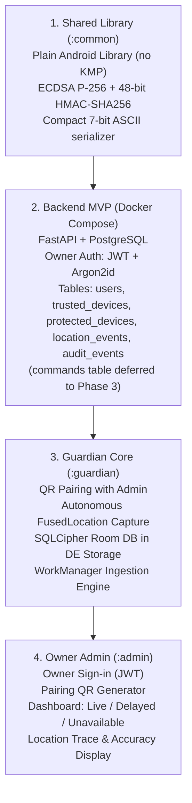

# Phase 1 Report: Inspection, Research & Security Feasibility (Updated)

> [!IMPORTANT]
> **Phase 1 Stop Gate Status**: Revised and updated based on architectural review. Ready for final user sign-off before commencing **Phase 2 (Vertical Slice)**.

---

## 1. Key Corrections & Platform Specifications

### 1.1 HMAC Specification: 48-Bit Truncated HMAC-SHA256 (12 Hex Characters)
- **Exact Length**: Exactly **48 bits** (6 bytes), represented as **12 hexadecimal characters** (e.g., `D9A2F80B31C5`).
- **Cryptographic Rationale**:
  - In an unfragmented GSM 7-bit SMS (160 character limit), every character is at a premium.
  - A 48-bit truncated HMAC-SHA256 provides a search space of $2^{48} \approx 2.81 \times 10^{14}$ possibilities.
  - In an online SMS attack, the attacker gets zero oracle feedback and only 1 guess per SMS sent.
  - Combined with SMS delivery latency (~1-2 seconds per message) and the Guardian token-bucket rate limiter, brute-forcing $2.81 \times 10^{14}$ possibilities is mathematically and financially infeasible (>281 trillion carrier SMS). 48 bits provides an optimal balance between cryptographic strength and PDU compactness.

### 1.2 Room DB Encryption & Direct Boot Exposure Trade-off
- **Encryption Engine**: Pinned to **SQLCipher for Android** (`net.zetetic:sqlcipher-android:4.5.5`).
- **Master Key**: Random 256-bit passphrase generated via `SecureRandom` and protected inside `AndroidKeyStore` using AES-256-GCM.
- **Direct Boot Mode (DE Storage)**:
  - Critical components (`BootReceiver`, `SmsReceiver`, and emergency sync queue) operate in `createDeviceProtectedStorageContext()` with `android:directBootAware="true"`.
- **The Data Exposure Trade-off**:
  - *Trade-off*: Device Protected (DE) storage is decrypted by the kernel at boot before the owner enters their lock-screen PIN/pattern. A sophisticated attacker with JTAG or kernel-level memory access could theoretically read DE storage from flash/RAM before First Unlock.
  - *Mitigation Policy*: Only ephemeral location fixes waiting for sync, the device alias, monotonic sequence counters, and the 48-bit SMS HMAC secret are allowed in DE storage. **No personal contacts, personal identity, or Recovery Vault documents are ever stored in DE storage**. All vault data strictly resides in Credential Protected (CE) storage or client-side AES-256-GCM encrypted blobs.

### 1.3 Device Owner Zero-Accounts Requirement
- **Platform Reality**: Android Enterprise architecture dictates that Device Owner (`DevicePolicyManager`) can **only be set on an unprovisioned device with ZERO user/Google accounts**.
- **Impact on In-Use Phones**: On an owner's or friend's existing personal phone, setting Device Owner mode **requires a full Factory Reset**.
- **Tier Routing**: Tier 3 (Device Owner) is designated for dedicated test hardware or freshly wiped devices. For existing personal phones that cannot be wiped, **Tier 2 (Normal App)** is the primary operational mode, providing full location tracking, offline encrypted queues, and SMS fallback without requiring Device Owner status.

### 1.4 Manifest-Registered Battery-Low Broadcast (`ACTION_BATTERY_LOW`)
- **Android 8.0+ Manifest Exemption**: `Intent.ACTION_BATTERY_LOW` is officially whitelisted under [Android Implicit Broadcast Exceptions](https://developer.android.com/guide/components/broadcast-exceptions). It can be declared in `AndroidManifest.xml` and triggers even if the app is killed.
- **Android 12 & 14 Background Restriction**: Calling `startForegroundService()` from `onReceive()` throws `ForegroundServiceStartNotAllowedException`.
- **Solution**: Inside `onReceive()`, the receiver calls `val pendingResult = goAsync()`. It has a 10–15 second window to fetch the latest location via `fusedLocationClient.getCurrentLocation(...)` (5s timeout), dispatch the 48-bit HMAC SMS, enqueue an expedited sync request with `WorkManager`, and invoke `pendingResult.finish()`.

---

## 2. Updated Capability Matrix (With Verification Status & Docs Links)

| Tier & Feature | Target OS | Verification Status | Real-World Limitation | Official Documentation Link |
|---|---|---|---|---|
| **Tier 1: Google Find Hub** | Android 9+ | **Pending Hardware Verification** | Guidance only. Zero 3rd-party API access to Bluetooth mesh. | [Find My Device Help](https://support.google.com/android/answer/6160491) |
| **Tier 1: Theft Detection Lock** | Android 15+ | **Pending Hardware Verification** | Uses device sensors & AI to lock screen on snatch. | [Android 15 Platform Features](https://developer.android.com/about/versions/15) |
| **Tier 1: Offline Device Lock** | Android 15+ | **Pending Hardware Verification** | Automatically locks screen when offline. | [Android 15 Platform Features](https://developer.android.com/about/versions/15) |
| **Tier 1: Power Menu Lock** | OEM-specific | **Pending Hardware Verification** | Not standard in AOSP; varies across Samsung, Pixel, Xiaomi. | [AOSP Power Management](https://source.android.com/docs/core/power) |
| **Tier 2: Autonomous GNSS** | API 26–34 | **Emulator-verified (API 34)** | Hardware satellite TTFF and indoor attenuation pending hardware. | [Location Strategies Guide](https://developer.android.com/develop/sensors-and-location/location/strategies) |
| **Tier 2: SQLCipher Room DB** | API 26–34 | **Emulator-verified (API 34)** | SQLCipher 4.5.5 in Direct Boot DE storage context. | [Room Persistence Library](https://developer.android.com/training/data-storage/room) |
| **Tier 2: SMS Fallback (48-bit HMAC)** | API 26–34 | **Emulator-verified (API 34)** | Direct APK only. Real carrier delivery pending hardware. | [SmsManager API Reference](https://developer.android.com/reference/android/telephony/SmsManager) |
| **Tier 2: Low-Battery Beacon** | API 26–34 | **Emulator-verified (API 34)** | Uses `goAsync()`. Sudden physical voltage collapse pending hardware. | [Broadcast Exceptions](https://developer.android.com/guide/components/broadcast-exceptions) |
| **Tier 2: Direct Boot Resume** | API 26–34 | **Emulator-verified (API 34)** | Resumes in DE storage before First Unlock. | [Direct Boot Developer Guide](https://developer.android.com/training/articles/direct-boot) |
| **Tier 2: Intruder Photo** | API 29–34 | **Pending Hardware Verification** | **Experimental**. Background camera blocked on Android 10+. | [Camera Restrictions](https://developer.android.com/about/versions/10/privacy/changes#camera-mic-background) |
| **Tier 3: Disallow Factory Reset** | API 26–34 | **Emulator-verified (API 34)** | Requires unprovisioned phone with zero accounts. | [UserManager.DISALLOW_FACTORY_RESET](https://developer.android.com/reference/android/os/UserManager#DISALLOW_FACTORY_RESET) |
| **Tier 3: Disallow Safe Boot** | API 26–34 | **Emulator-verified (API 34)** | Disables Safe Mode boot menu. | [UserManager.DISALLOW_SAFE_BOOT](https://developer.android.com/reference/android/os/UserManager#DISALLOW_SAFE_BOOT) |
| **Tier 3: Lock-Task (Kiosk)** | API 26–34 | **Emulator-verified (API 34)** | Pins recovery screen; hides navigation and power dialog. | [Lock Task Mode Guide](https://developer.android.com/work/dpc/dedicated-devices/lock-task-mode) |
| **Hardware Force-Poweroff** | All | **Hardware Constraint** | Silicon PMIC cut-off cannot be blocked by any software. | [AOSP Power Subsystem](https://source.android.com/docs/core/power) |

---

## 3. Open Unresolved Questions (Pending Real Hardware)

1. **Battery-Low Delivery Headroom**: On aging lithium-ion batteries with high internal resistance, does `ACTION_BATTERY_LOW` fire with sufficient voltage reserve before the PMIC abruptly cuts power during cellular modem transmit spikes?
2. **OEM Power Menu Lock Behavior**: Which specific OEM skins (Samsung One UI vs. Xiaomi HyperOS vs. Transsion vs. Pixel) reliably enforce biometric unlock before allowing power menu access?
3. **Carrier SMS Spam Filtering**: Do specific cellular carriers (MVNOs or tier-1 carriers) delay or throttle structured piped ASCII payloads (`ST:...`) between physical SIM cards?
4. **Aggressive OEM Task Killers**: How do aggressive OEM battery savers (e.g., Xiaomi MIUI/HyperOS, Huawei, Oppo) affect `WorkManager` background sync workers and Direct Boot startup receivers?
5. **Direct Boot Storage Trade-off**: Validation of the exact minimum metadata footprint permitted in DE storage to ensure zero leak of owner personal identity before First Unlock.

---

## 4. Trimmed Phase 2 Roadmap (Vertical Slice)

Following your guidance, Phase 2 is lean and focused strictly on the core vertical slice:

1. **Shared Library (`:common`)**:
   - Plain Android Library module (no Kotlin Multiplatform).
   - Asymmetric crypto: **ECDSA P-256 (`secp256r1`)** in `AndroidKeyStore`.
   - Symmetric crypto: **48-bit truncated HMAC-SHA256** (12 hex chars).
2. **Backend MVP (FastAPI + PostgreSQL in Docker Compose)**:
   - Owner authentication: `POST /auth/login` (OAuth2 password flow with Argon2id), issuing short-lived Bearer JWT.
   - Simplified schema: `users`, `trusted_devices`, `protected_devices`, `location_events`, and `audit_events`.
   - `commands` and `vault_objects` tables explicitly moved to Phase 3 and Phase 4.
3. **Guardian Core (`:guardian`)**:
   - Pairing with Admin via QR code.
   - Autonomous GNSS acquisition via `FusedLocationProviderClient`.
   - Local offline queue in SQLCipher Room DB using `DeviceProtectedStorageContext`.
   - `WorkManager` sync worker delivering idempotent batches with exponential backoff.
4. **Owner Admin Core (`:admin`)**:
   - Owner sign-in screen.
   - QR code pairing generator for enrolling new Guardian devices.
   - Dashboard displaying device list with *Live*, *Delayed*, or *Unavailable* status indicators and coordinate accuracy radius.

---

## 5. Documentation Deliverables Checklist

- [x] [docs/capability_matrix.md](file:///home/sam/Documents/she/docs/capability_matrix.md): Complete matrix with verification status and official Android documentation links.
- [x] [docs/threat_model.md](file:///home/sam/Documents/she/docs/threat_model.md): Assets, adversary profiles, SQLCipher Room details, Direct Boot DE exposure trade-offs, and physical non-goals.
- [x] [docs/sms_and_device_owner_feasibility.md](file:///home/sam/Documents/she/docs/sms_and_device_owner_feasibility.md): 48-bit HMAC specification, battery-low broadcast analysis, no-accounts warning, and open questions.
- [x] [docs/architecture.md](file:///home/sam/Documents/she/docs/architecture.md): Full system architecture, trimmed Phase 2 schema, ECDSA P-256, and owner JWT authentication.
- [x] [docs/distribution_decision.md](file:///home/sam/Documents/she/docs/distribution_decision.md): Direct APK vs Google Play analysis and dual build flavor configuration.
- [x] [docs/permissions_and_privacy.md](file:///home/sam/Documents/she/docs/permissions_and_privacy.md): Owner consent model and data retention rules.
