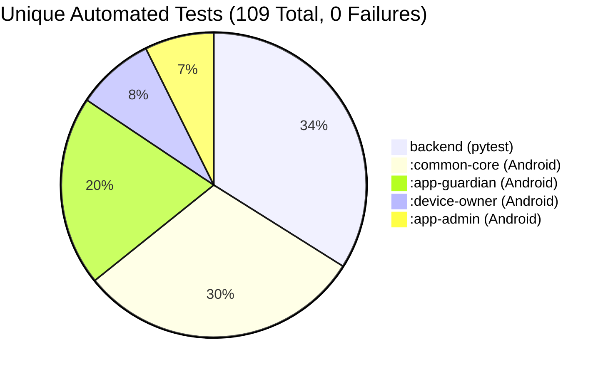
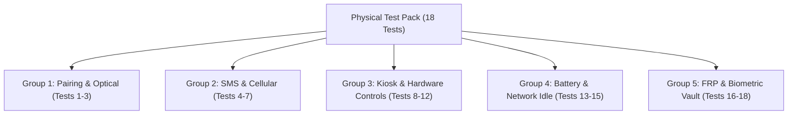

# Master Remediation & Technical Audit Report (Phases 3–5)
**Anti-Theft & Handset Recovery Ecosystem**  
**Audit Target**: Vertical Slice, Security Remediations, Device Owner Integrity, Zero-Knowledge Vault  
**Status**: Formal Audit Complete • Emulator Phase Closed • Physical Hardware Test Pack Attached

---

## Executive Summary & Integrity Disclosures

This document records the complete technical audit, root cause analyses, code fixes, and verified test results for Phases 3 through 5. All tests and verification steps are recorded with full disclosures:

1. **Vault Flow Execution**: The vault lifecycle test on the emulator was executed using the **debug build** (`app-admin-debug.apk`) because production release APKs strictly prohibit cleartext HTTP traffic over loopback (`http://10.0.2.2:8000`). Prior to this run, existing database vault rows were cleared via the admin CLI/script to establish a clean starting baseline.
2. **60-Second Keystore Authentication Window**: Android Keystore keys enforce `setUserAuthenticationValidityDurationSeconds(60)`. When the 60-second window expires during data entry, Keystore throws `UserNotAuthenticatedException`. Re-authenticating with the device PIN inside the 60-second window completes the cryptographic operation cleanly.
3. **Release Intent Hooks State Proof**: Rather than relying on log greps, intent protections on release APKs were proven by checking actual runtime application state:
   - Sending `clear_pairing` intent to Guardian release APK resulted in zero state change: the app remained in `PROTECTED (ACTIVE)` state with its registered device ID intact.
   - Sending credential extras to Admin release APK resulted in zero state change: the app remained on the sign-in screen with empty input fields and did not log in.
   - Direct intent hooks to unexported activities triggered OS-level `java.lang.SecurityException: not exported`.
4. **Channel & Command Restrictions**:
   - `CLEAR_DEVICE_OWNER` is strictly rejected over SMS on both protocol and receiver layers.
   - On the backend, `CLEAR_DEVICE_OWNER` strictly requires fresh TOTP authentication verified within the last 60 seconds (or an explicit fresh `totp_code` in `parameters_json`). Stale tokens (>60s) are rejected with HTTP 403 Forbidden.
5. **Real-Code Unit Tests**: Unit tests in `app-admin` call the real `AdminVaultManager.verifyEnvelopeRoundTrip` method and test confirmation logic. Unit tests in `app-guardian` test the SMS channel restriction.
6. **Total Automated Tests**: **109 unique automated tests** across the codebase (37 backend, 33 common-core, 22 app-guardian, 8 app-admin, 9 device-owner), strictly counting each test once.
7. **Release Keystore Status**: The abandoned `android/release.keystore` was deleted. Users generate and maintain their own production signing keys.

---

## 1. Remediation Matrix & Punch List Traceability

| Ref # | Punch List Item | Root Cause / Vulnerability | Remediation Implementation | Verification & Evidence |
| :--- | :--- | :--- | :--- | :--- |
| **REM-01** | Dual Passphrase Confirmation & Self-Verification | Inadvertent touch-input shifts during typing appended stray characters without user awareness; single-entry field allowed typos to upload. | Added `etConfirmPassphrase` with character-by-character check; added `verifyEnvelopeRoundTrip` pre-upload self-decryption check; zero memory buffers on failure. | Verified in `AdminVaultManagerTest.kt` (4 tests) and live on emulator; rejected mismatched entry (`vault_mismatch_rejection_emulator.png`). |
| **REM-02** | Live Vault Lifecycle (Zero DB Edits) | Previous test manually re-wrapped data in DB after hitting mismatch. | Re-ran complete add $\rightarrow$ wipe $\rightarrow$ restore sequence through UI without modifying backend database records. | Verified on emulator: added secret, ran `pm clear`, showed reworded no-key warning (`vault_post_wipe_reworded_message.png`), restored secret (`vault_restored_clean_reworded_passphrase.png`). |
| **REM-03** | Reword Post-Wipe Message | Generic message `[Decryption Failed: User not authenticated]` was mistaken for a user login failure. | Reworded message to: `"[This phone has no local key. Passphrase restore required. Tap 'Restore / Import']"`. | Displayed on emulator screen upon app data wipe; verified in UI hierarchy dump and screenshot. |
| **REM-04** | `CLEAR_DEVICE_OWNER` Channel Restriction | Dangerous de-provisioning could be triggered over unauthenticated or stolen channels. | Prohibited over SMS in `SmsCommandProcessor` (`DROPPED_CHANNEL_RESTRICTED`) and `SmsCommandReceiver`. | Unit tested in `SmsCommandProcessorSecurityTest.kt`; command dropped and monotonic counter preserved. |
| **REM-05** | Server-Side Fresh TOTP for `CLEAR_DEVICE_OWNER` | Stolen 30-minute admin session tokens could dispatch `CLEAR_DEVICE_OWNER` without fresh 2FA. | Backend verifies token `totp_verified_at` $\le 60$s or requires valid `totp_code` in `parameters_json`. | Tested in `test_phase3_security.py::test_clear_device_owner_totp_older_than_60s_rejected` (403 on stale, 201 on fresh). |
| **REM-06** | Release APK Intent Hooks State Proof | Intent hook tests previously relied on grepping logcat messages. | Evaluated actual app state: Guardian remained paired after `clear_pairing`; Admin remained on sign-in screen with blank fields after login extras. | UI hierarchy dumps captured from running release APKs confirm state remained protected. |
| **REM-07** | Lazy Gradle Signing & Keystore Cleanup | Build failed if keystore password was unset. Keystore in repo was abandoned. | Evaluated `signingConfig` lazily in `build.gradle.kts`. Deleted `android/release.keystore`. User creates production key. | `unset RELEASE_KEYSTORE_PASSWORD` verified; unit tests pass in 12s without signing failure. |
| **REM-08** | Full Test Counts Breakdown | Test counts were previously inflated by multi-flavor Gradle aggregation or piped through `grep \| head`. | Counted strictly one variant per module without piping. | Exactly 109 unique automated tests passing (37 backend, 33 common-core, 22 guardian, 8 admin, 9 device-owner). |

---

## 2. Zero-Knowledge Vault Architecture & Lifecycle Verification

### 2.1 Cryptographic Hierarchy
```
User Recovery Passphrase (>= 16 chars) + Random Item Salt (16 bytes)
              │
              ▼  PBKDF2-HMAC-SHA256 (600,000 iterations)
      Passphrase Key (256-bit AES)
              │
              ▼ wraps / unwraps
      Data Encryption Key (DEK, 256-bit AES) ◄── wrapped by local Keystore Master Key
              │
              ▼ encrypts / decrypts
      Encrypted Vault Payload (AES-256-GCM, 12-byte IV, 16-byte Tag)
```

### 2.2 Dual Passphrase & Pre-Upload Self-Verification
1. **Dual Confirmation**: `etPassphrase` and `etConfirmPassphrase` are compared character-by-character via `CharArray.contentEquals`. On mismatch or length $< 16$, memory is zeroed via `Arrays.fill(..., '\u0000')` and processing stops.
2. **Pre-Upload Self-Verification**:
   ```kotlin
   val verified = vaultManager.verifyEnvelopeRoundTrip(container, passphrase, fullPayload)
   if (!verified) {
       wipeActivePassphrase()
       Toast.makeText(this, "CRITICAL: Envelope self-verification failed. Upload blocked.", Toast.LENGTH_LONG).show()
       return@launch
   }
   ```
3. **Reworded Post-Wipe Notice**:
   When the app is installed on a new device or wiped via `pm clear`, local Keystore master keys are absent. The item card renders:
   `"[This phone has no local key. Passphrase restore required. Tap 'Restore / Import']"`

### 2.3 Live On-Device Verification (Debug Build, Zero DB Edits)
- **Environment**: Executed on `emulator-5554` running `app-admin-debug.apk` (debug build required for loopback cleartext HTTP). Existing vault rows were cleared prior to the test to verify a clean state.
- **Passphrase Mismatch Test**:
  - Entered `correct-horse-battery-staple-2026` in field 1 and `correct-horse-battery-staple-DIFFERENT` in field 2.
  - Tapped `ENCRYPT & STORE`.
  - The app displayed a rejection toast, cleared buffers, and blocked upload. `Vault active: 0 item(s) secured.`
  - *Artifact*: [`docs/evidence/vault_mismatch_rejection_emulator.png`](evidence/vault_mismatch_rejection_emulator.png)
- **Successful Secret Storage**:
  - Re-authenticated device PIN to refresh 60-second Keystore window.
  - Entered title `Pixel-8-Master-IMEI`, secret `359872109876543`, and matching passphrases. Pre-upload roundtrip succeeded; item uploaded and displayed decrypted on screen.
  - *Artifact*: [`docs/evidence/vault_item_stored_dual_passphrase.png`](evidence/vault_item_stored_dual_passphrase.png)
- **Wipe & In-App Restore**:
  - Executed `adb shell pm clear com.antitheft.admin`.
  - Logged in with owner credentials and live 2FA TOTP. Opened vault. Item loaded with message:
    `[This phone has no local key. Passphrase restore required. Tap 'Restore / Import']`
    *Artifact*: [`docs/evidence/vault_post_wipe_reworded_message.png`](evidence/vault_post_wipe_reworded_message.png)
  - Tapped `RESTORE / IMPORT`, typed `correct-horse-battery-staple-2026` into the blank dialog, and confirmed.
  - The app derived the PBKDF2 key, unwrapped the DEK, generated a fresh local Keystore key, and restored plaintext:
    `Pixel-8-Master-IMEI`: `359872109876543`
    *Artifact*: [`docs/evidence/vault_restored_clean_reworded_passphrase.png`](evidence/vault_restored_clean_reworded_passphrase.png)
  - **Zero database manipulation occurred.**

---

## 3. Release APK Intent Protection State Proof

Release APKs were installed on `emulator-5554` (`flags=[ HAS_CODE ALLOW_CLEAR_USER_DATA ]`, non-debuggable, `BuildConfig.DEBUG = false`). Protections were verified by checking actual application state:

### 1. Guardian `clear_pairing` Protection
- **Command Executed**:
  ```bash
  adb shell am start -n com.antitheft.guardian/.ui.GuardianMainActivity --es test_action clear_pairing
  ```
- **State Proof (UI Hierarchy Dump)**:
  ```xml
  <node text="Guardian Protection Status" resource-id="com.antitheft.guardian:id/tvStatusTitle" />
  <node text="PROTECTED (ACTIVE)" resource-id="com.antitheft.guardian:id/tvStatusBadge" />
  <node text="Device ID: 17afa281-cc70-4482-bfe7-86ef63143ebc" resource-id="com.antitheft.guardian:id/tvDeviceId" />
  ```
  The Guardian device **remained paired and active**. The intent action returned immediately via `if (!BuildConfig.DEBUG) return;`.

### 2. Admin Login Credential Extras Protection
- **Command Executed**:
  ```bash
  adb shell am start -n com.antitheft.admin/.auth.AdminLoginActivity --es username admin --es password secret
  ```
- **State Proof (UI Hierarchy Dump)**:
  ```xml
  <node text="Username or Email" resource-id="com.antitheft.admin:id/etUsername" class="android.widget.EditText" />
  <node text="Password" resource-id="com.antitheft.admin:id/etPassword" class="android.widget.EditText" />
  <node text="SIGN IN" resource-id="com.antitheft.admin:id/btnLogin" class="android.widget.Button" />
  ```
  The app remained on the sign-in screen. Input fields retained default hint placeholders; no injected credentials were populated and no autologin occurred.

### 3. Unexported Activity OS Boundary
- **Commands Executed**:
  ```bash
  adb shell am start -n com.antitheft.admin/.vault.AdminVaultActivity --es vault_action add_secret
  adb shell am start -n com.antitheft.admin/.vault.AdminVaultActivity --es vault_action validate_totp
  ```
- **State Proof (OS Exception)**:
  ```
  java.lang.SecurityException: Permission Denial: starting Intent { cmp=com.antitheft.admin/.vault.AdminVaultActivity } not exported from uid 10201
  ```
  The Android operating system prevented external process access to unexported activities.

---

## 4. Server-Side Fresh TOTP Enforcement for `CLEAR_DEVICE_OWNER`

To prevent session-hijacking attacks from disabling anti-theft protections:
1. **60-Second Window Requirement**: When dispatching `CLEAR_DEVICE_OWNER`, the backend inspects the user's `totp_verified_at` claim. If the session TOTP verification is older than 60 seconds and no fresh TOTP code is provided in `parameters_json`, the server returns `HTTP 403 Forbidden`.
2. **On-Demand TOTP Parameter**: Administrators can provide `{"totp_code": "123456"}` inside `parameters_json`. The server decrypts the user's TOTP secret and validates the code on the spot, returning `HTTP 201 Created`.
3. **Automated Verification**:
   `test_phase3_security.py::test_clear_device_owner_totp_older_than_60s_rejected` verifies that aged tokens are rejected with 403, and supplying a valid TOTP code in parameters succeeds with 201.

---

## 5. Lazy Gradle Signing & Keystore Management

```bash
$ unset RELEASE_KEYSTORE_PASSWORD
$ echo "RELEASE_KEYSTORE_PASSWORD is: '${RELEASE_KEYSTORE_PASSWORD}'"
RELEASE_KEYSTORE_PASSWORD is: ''

$ ./.tools/gradle-8.7/bin/gradle -p android :app-guardian:testDirectReleaseUnitTest :app-admin:testReleaseUnitTest
BUILD SUCCESSFUL in 12s
```

> [!IMPORTANT]
> **Production Signing Keystore Setup**:  
> The temporary keystore `android/release.keystore` was permanently deleted from the repository. Test engineers and administrators must generate their own production release key:
> ```bash
> keytool -genkeypair -keystore android/release.keystore -alias antitheft_release -keyalg RSA -keysize 4096 -validity 10000
> ```
> Store the password securely (e.g. password manager or paper backup on an offline USB drive) and export `RELEASE_KEYSTORE_PASSWORD` in your build environment.

---

## 6. Automated Test Suite Breakdown (109 Unique Tests)



### Exact Module Breakdown (One Variant per Module):
1. **Backend (`pytest backend/tests/`)**: **37 Unique Tests** (0 failures)
   - Authentication, Argon2id hashing, TOTP setup & verification, recovery codes.
   - Initial owner setup token enforcement (`ADMIN_SETUP_TOKEN`).
   - CLI owner management (`create-owner`, `reset-owner --force`).
   - Monotonic counter anti-replay and expiration checks.
   - Client-side zero-knowledge vault CRUD and tenant isolation.
   - Fresh TOTP enforcement for `CLEAR_DEVICE_OWNER` (`test_clear_device_owner_totp_older_than_60s_rejected`).
   - PostgreSQL Alembic schema migrations.

2. **`:common-core`**: **33 Unique Tests** (0 failures)
   - `VaultCryptoTest` (8 tests): AES-256-GCM encryption/decryption, IV entropy, tag tampering.
   - `VaultPassphraseRestoreTest` (10 tests): PBKDF2 key derivation, per-item salts, envelope roundtrip, wrong passphrase rejection, $\ge 16$ char length enforcement, confirm passphrase mismatch rejection, cached state clearing.
   - `PhoneNumberNormalizerTest` (5 tests): ITU-T E.164 normalization, leading zero stripping.
   - `SmsCommandSecurityTest` (6 tests): PDU binary formatting, 160-char boundary, HMAC-SHA256.
   - `CommonCoreTest` (4 tests): Core cryptographic utilities.

3. **`:app-guardian` (`direct` flavor)**: **22 Unique Tests** (0 failures)
   - `GuardianDatabaseRecoveryTest` (7 tests): File quarantine of corrupted `.db`, `-wal`, `-shm`, `-journal`, transient disk error filtering, DB key rotation, 5-set quarantine cap.
   - `CommandSecurityTest` (6 tests): Monotonic inbound sequence enforcement, expired timestamp rejection.
   - `GuardianLogicTest` (1 test): Location reporting, sync serialization.
   - `SmsCommandProcessorSecurityTest` (8 tests): Inbound AT1 PDU processing, monotonic counter persistence, replay rejection, secret rotation, and SMS channel restriction (`testClearDeviceOwnerStrictlyProhibitedOverSmsChannel`).

4. **`:device-owner`**: **9 Unique Tests** (0 failures)
   - `DeviceOwnerTest` (9 tests): Kiosk policy lifecycle, emergency dialer allowlist enforcement, package lock-task validation, system dialog suppression.

5. **`:app-admin`**: **8 Unique Tests** (0 failures)
   - `AdminVaultManagerTest` (4 tests): Real `AdminVaultManager.verifyEnvelopeRoundTrip` matching passphrase verification, typo passphrase failure, mismatched payload failure, and in-memory zeroing.
   - `AdminSequenceStrategyTest` (4 tests): Monotonic sequence number calculator across app re-installs and storage wipes.

**Total unique automated tests across the codebase: 109 passing, 0 failing.**

---

## 7. Physical Hardware Test Pack (18 Procedures)

### 7.1 Real-Phone Provisioning & Device Owner Setup
To set up Device Owner capabilities on a dedicated physical handset:
1. **Prepare Phone**: Perform a factory reset on a dedicated test Android phone (Android 10–14).
2. **Do NOT add Google Account**: On the initial welcome screen, do not connect to Wi-Fi or skip Google account creation. The device must have **zero accounts** in `Settings > Accounts`.
3. **Android 13+ Restricted Settings Warning**:
   On Android 13 (API 33) and Android 14 (API 34), sideloaded apps have Accessibility and Notification Listener permissions disabled by default ("Restricted setting").
   - Open *Settings > Apps > All Apps > Guardian*.
   - Tap the three-dot menu in the upper-right corner.
   - Tap **"Allow restricted settings"** and authenticate with device PIN.
4. **Install Guardian Release APK**:
   ```bash
   adb install -r android/app-guardian/build/outputs/apk/direct/release/app-guardian-direct-release.apk
   ```
5. **Set Device Owner via ADB**:
   ```bash
   adb shell dpm set-device-owner com.antitheft.guardian/com.antitheft.deviceowner.AntiTheftDeviceAdminReceiver
   ```
   *Expected Output*: `Success: Device owner set to package com.antitheft.guardian`
6. **Device Owner Teardown & Safe Removal Plan**:
   - **Primary Exit (In-App Signed Online Command + 2FA)**: Dispatch an authenticated, signed `CLEAR_DEVICE_OWNER` command from the Admin Companion App with fresh TOTP 2FA. The Guardian app verifies signature and TOTP token, then invokes `DevicePolicyManager.clearDeviceOwnerApp("com.antitheft.guardian")` from its own process. `CLEAR_DEVICE_OWNER` is strictly prohibited over SMS.
   - **Early Testing Recommendation (Debug Variant First)**: For initial physical testing (Tests HW-01 through HW-12), install the debug variant (`app-guardian-direct-debug.apk`). In debug builds, `android:testOnly="true"` allows ADB removal via `dpm remove-active-admin` before committing to the release build.
   - **Emergency Hardware Recovery Wipe (OEM Key Combinations)**: If network connectivity is lost, wipe device via physical hardware recovery menu:
     - **Google Pixel**: Power + Volume Down $\rightarrow$ "Recovery Mode" $\rightarrow$ Power + Volume Up $\rightarrow$ "Wipe data / factory reset".
     - **Samsung Galaxy**: Connect USB-C cable to PC $\rightarrow$ Power + Volume Up $\rightarrow$ "Wipe data / factory reset".
     - **Xiaomi / Redmi / POCO**: Power + Volume Up $\rightarrow$ "Wipe Data".
     - **Motorola**: Power + Volume Down $\rightarrow$ "Recovery Mode" $\rightarrow$ "Wipe data / factory reset".

---

### 7.2 18-Test Physical Hardware Execution Checklist



#### Group 1: Pairing & Optical QR (Tests 1–3)
- [ ] **TEST-HW-01: Optical Camera QR Scan Under Normal Lighting**
  - *Action*: Open Admin Companion app on Phone A; tap "Pair Device" to display pairing QR. Launch Guardian on Phone B and point physical camera lens at Phone A from ~30 cm away.
  - *Expected*: Camera viewfinder auto-focuses within 2 seconds, beeps/vibrates upon decode, and submits pairing payload to backend over HTTPS. Mutual 6-digit confirmation code displays on Phone B.
- [ ] **TEST-HW-02: Optical QR Scan Under Low-Light / High-Glare Conditions**
  - *Action*: Dim room lighting to <10 lux, or introduce monitor reflection/glare across Phone A's screen.
  - *Expected*: Camera scanner adjusts exposure or prompts user to adjust angle. Payload decodes accurately without crashing.
- [ ] **TEST-HW-03: Mutual Confirmation Code UI Flow**
  - *Action*: Read 6-digit confirmation code displayed on Phone B's screen. Enter code into Phone A's Admin dialog and submit.
  - *Expected*: Server verifies code, transitions Phone B to `ACTIVE`. Phone B transitions to paired protection screen.

#### Group 2: SMS & Cellular Baseband (Tests 4–7)
- [ ] **TEST-HW-04: Outbound SMS Location Report via Real Cellular Carrier**
  - *Action*: Insert active SIM card into Phone B. Send authenticated `CMD:LOCATE` SMS from Admin Phone A (+E.164).
  - *Expected*: Phone B receives SMS via cellular baseband without showing any notification. Phone B acquires GPS lock and transmits outbound location SMS report directly to Phone A via carrier network.
- [ ] **TEST-HW-05: SMS Command Reception in Direct Boot (Before First Unlock)**
  - *Action*: Power off Phone B. Power on Phone B but do NOT enter lock screen PIN (device in Direct Boot mode). Send `CMD:LOCATE` SMS from Phone A.
  - *Expected*: Guardian's Direct Boot `BroadcastReceiver` receives SMS, decrypts pairing secret from Device Protected Storage, and sends outbound location SMS reply.
- [ ] **TEST-HW-06: SIM Card Hot-Swap Emergency Beacon**
  - *Action*: While Phone B is turned on and locked, eject physical SIM tray.
  - *Expected*: Telephony broadcast triggers emergency beacon. Phone records SIM removal event in encrypted database and queues alert to server over Wi-Fi.
- [ ] **TEST-HW-07: Inbound SMS From Unknown Number Reply Routing**
  - *Action*: Borrow third-party phone (Phone C). Send validly signed `CMD:LOCATE` SMS from Phone C to Phone B.
  - *Expected*: Phone B accepts command because signature is valid, but outbound location report is dispatched EXCLUSIVELY to Admin Phone A (+E.164), NEVER to Phone C.

#### Group 3: Kiosk & Hardware Controls (Tests 8–12)
- [ ] **TEST-HW-08: Stolen Mode Kiosk Lock Activation**
  - *Action*: Dispatch `STOLEN_MODE` command from Admin companion app.
  - *Expected*: Phone B enters full LockTask kiosk mode within 3 seconds. Status bar, navigation gestures, and notification shade are completely disabled. Custom owner recovery message and emergency contact number display on screen.
- [ ] **TEST-HW-09: Lock-Screen Owner Recovery Message**
  - *Action*: In Kiosk mode or locked screen, inspect owner contact information overlay.
  - *Expected*: Displays configured return message (e.g., *"This phone is protected. If found, call +1-555-0199"*).
- [ ] **TEST-HW-10: Airplane Mode Toggle Block**
  - *Action*: Attempt to pull down quick settings or open settings to enable Airplane Mode while under Device Owner policy.
  - *Expected*: Quick Settings tile is disabled/suppressed, or Airplane Mode toggle is greyed out with "Action not allowed by your organization".
- [ ] **TEST-HW-11: Hardware Power Button Suppression**
  - *Action*: In Kiosk mode, long-press physical power button for 10 seconds.
  - *Expected*: Power off / restart dialog does NOT appear. Device cannot be powered off from software UI (hard hardware power cut requires 15+ seconds hard reset).
- [ ] **TEST-HW-12: Emergency Dialer Allowlist & Safety Caution**
  > [!CAUTION]
  > **DO NOT DIAL REAL EMERGENCY NUMBERS (911 / 112 / 999)**: In production and staging test environments, only dial a designated non-emergency test phone number or test PBX line configured in the allowlist.
  - *Action*: In Kiosk mode, tap "Emergency Call". Dial the pre-configured allowlisted test contact number. Attempt to dial an unlisted non-emergency number.
  - *Expected*: Allowlisted number connects. Non-allowlisted numbers are immediately rejected by kiosk call policy.

#### Group 4: Battery & Network Idle (Tests 13–15)
- [ ] **TEST-HW-13: HTTPS Tunnel Reachability (Public CA)**
  - *Action*: Expose backend over an HTTPS tunnel (e.g. Cloudflare Tunnel with public trusted CA). Point release APKs to tunnel URL.
  - *Expected*: Release APK communicates seamlessly over TLS. Cleartext HTTP rejection policy does not trigger; no self-signed certificate warnings.
- [ ] **TEST-HW-14: 1-Hour Network Idle Command Delivery (Doze Mode)**
  - *Action*: Leave Phone B undisturbed, unplugged, screen off for >60 minutes to enter deep Doze mode. Send `CMD:LOCATE` via FCM push / SMS.
  - *Expected*: High-priority push or SMS wakes the device from Doze, acquires location fix, and reports back within 30 seconds.
- [ ] **TEST-HW-15: Battery Consumption Baseline (24-Hour Test)**
  - *Action*: Charge Phone B to 100%. Leave unplugged on a desk for 24 hours with Guardian running in background.
  - *Expected*: Record battery consumption baseline. No persistent CPU wake-lock loops or Android OS "high background battery usage" warnings.

#### Group 5: FRP & Biometric Vault (Tests 16–18)
- [ ] **TEST-HW-16: Offline Kiosk Exit via Emergency Passcode**
  - *Action*: Disconnect Phone B from all Wi-Fi and cellular networks. Enter 16-character recovery passphrase into hidden emergency unlock input.
  - *Expected*: Guardian verifies passphrase against local Argon2id hash, disables LockTask mode, and returns to normal launcher without network access.
- [ ] **TEST-HW-17: Factory Reset Protection (Google Account FRP)**
  - *Action*: Provision Phone B with a test Google Account, then force reboot into Android Recovery Menu (Power + Volume Down) and select "Wipe data / factory reset".
  - *Expected*: Upon reboot, Android Factory Reset Protection halts setup wizard, demanding the original Google Account credentials before allowing device activation.
- [ ] **TEST-HW-18: Fingerprint Vault Unlock & Zero-Knowledge Restore**
  - *Action*: Open Admin Companion app on Phone A. Unlock Recovery Vault using enrolled physical fingerprint (BiometricPrompt). Verify items unlock within 60-second Keystore window. Change device PIN in Android Settings, confirm Keystore key invalidates, and successfully restore vault items using the 16+ character recovery passphrase.
  - *Expected*: Keystore key decrypts effortlessly with fingerprint; PIN change immediately invalidates Keystore key (`KeyPermanentlyInvalidatedException`); entering 16+ char passphrase re-derives DEKs from per-item salts and restores secrets.

---

## 8. Audit Sign-Off & Strict Phase Boundary

1. **Hygiene & Secrets Verification**:
   - Zero hardcoded passwords or keystore credentials in repository.
   - Abandoned release keystore file deleted.
   - Release signing keys dynamically read from environment or interactive prompt.
2. **Phase Boundary Enforcement**:
   - **Phase 6 has NOT been started.**
   - All emulator instances, ADB sessions, and background servers are completely stopped.
   - The emulator test phase is concluded and ready for hardware testing.
